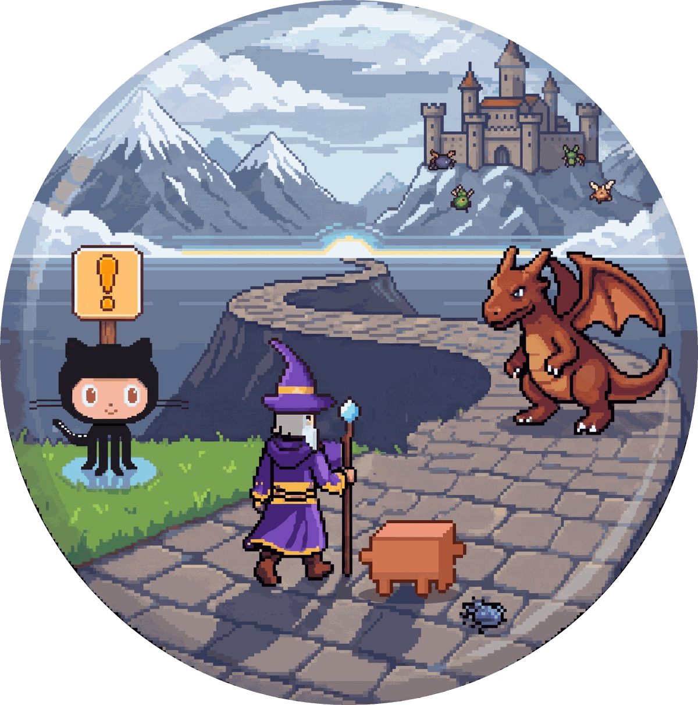

<p align="center">
  
</p>

<h1 align="center">Quest HUD</h1>

<p align="center">A Claude Code mod that draws the session as a small game: HP and MP bars for the weekly limit and the context window, and the skill and tasks you are on.</p>

<p align="center">
    <a href="https://github.com/matasarei/quest-hud/actions/workflows/checks.yml"></a>
</p>

A Claude Code mod that draws your session as a small game, above the prompt:

```
[avatar]  ⚔ gku:implement  Forge  task 2/5 · Write the CSV writer tests
          ♥ HP █████████░░░░░ 62% week · heals in 2d 4h   ✦ MP ████████░░░░░░ 59% ctx · 82k/200k
```

- **♥ HP (green)**: what is left of your weekly usage window.
- **✦ MP (blue)**: what is left of the context window.
- **⚔ the quest**: the skill that is running (any skill, from any plugin) and the **zone** it
  works in, or the **Wilds** when none is; and Claude Code's own task list: how many tasks are
  done and which one is in progress. Your prompts are never shown — you just typed them. A
  skill's quest ends when you ask for something new (three words or more) with no task open.

It works with whatever skills you use. A skill's zone comes from its name and description:

| Zone | Means | Skills like |
|---|---|---|
| Map room | planning and research | plan, research, design, spec |
| Forge | building and fixing | implement, fix, build, refactor |
| Arena | review and tests | review, verify, test, lint |
| Harbour | pull requests and releases | pr, mr, merge, release, deploy |
| Watchtower | reviewing someone else's change | a name with review and pr/mr |
| Dungeon | auditing the whole repository | audit, security |
| Camp | setup and docs | init, setup, config, docs |
| Wilds | no skill running | anything else |

## Contents

- [The Road](#the-road)
- [Install](#install)
- [Options](#options)
- [Without mods](#without-mods)
- [Development](#development)
- [License](#license)

## The Road

`/hud pane` opens the Road beside the transcript (docked in fullscreen from 110 columns,
inline above the prompt below that):

```
⚔ gku:implement · Forge — building and fixing        task 2/5 · loot 1
[the zone's scene, 14 rows of pixel art: its landscape behind, its landmarks, a flag
 per task (green done, gold in progress, grey to do), the purple wizard beside the
 one in progress with Claude's mascot at his heel, a little daemon-ghost behind for
 each subagent, a monster facing the wizard while a fight is on or lost, and a chest,
 GitHub's Octocat and GitLab's fox once they came — they walk while Claude works]
with Explore
✓ Read the exporter
✓ Add the CSV writer
▸ Write the CSV writer tests
· Wire it in
♥ ████████░░ 80%   ✦ █████░░░░░ 57%
— log —
19:04 skill gku:implement · Forge
19:05 scout read 3 files · 1 search
19:06 cast  csv.ts +4 -7
19:06 fork  Explore joined
19:07 fight tests lost · 231 pass · 1 fail
19:09 fight tests won · 232 pass · 0 fail
19:10 loot  2af33ea Write the CSV writer tests
19:11 ally  PR #3 opened
```

The log is what Claude did, from what Claude Code reports: skills, reads and searches, edits
with lines added and removed, tasks done, plan mode, subagents joining and leaving,
compaction, and the Bash commands below. A new session (`/clear`) starts the Road over.

**Fights, loot and allies.** Some of the commands Claude runs in Bash show on the Road. The
HUD reads only the command and its output, and never shows a command as it was typed.

| Command | On the Road | In the log |
|---|---|---|
| a test run: `npm test`, `pytest`, `go test`, `cargo test`, `phpunit`, `rspec`, `bun test`, `claude plugin test` and others | a monster while it runs, the room's own indoors: a **skeleton** in the Dungeon, a **fire golem** in the Forge, **flying books** in the Map room, and a **dragon** everywhere else. It stays after a failed run, the wizard holding his ground against it instead of walking on — the two trade blows — until a run of the same kind passes | `fight tests won` or `lost`, with the score when the output shows one |
| a lint or type check: `eslint`, `ruff check`, `mypy`, `tsc --noEmit`, `shellcheck`, `phpcs`, `npm run lint` and others | a **spider**, the same way | `fight lint won` or `lost` |
| `git commit` | a **chest**, and `loot N` in the header | `loot`, with the commit's short sha and subject |
| `gh` | **GitHub's Octocat**, for the rest of the session | `ally PR #3 opened`, `merged`, `ready`, `closed`, checks passed or failed |
| `glab` | **GitLab's fox**, a fox of crystal facets, for the rest of the session | `ally MR !12 opened`, and so on |

Wrapped commands count too (`cd app && npm test`, `timeout 300 pytest`, `docker compose exec
app vendor/bin/phpunit`, `uv run pytest`); a mention does not (`echo "npm test"`, `grep
pytest`). A subagent's test and lint runs are fights, led by its name in the log; its commits
and gh calls are not. A run sent to the background, or interrupted, has no outcome and
changes nothing.

**On a narrow pane** the road keeps room for the wizard, three task flags (the one in progress
and one each side) and any monster. To make that room, things give way in turn: the zone's
landmarks from the left, keeping its last one, then the fox, the Octocat and the chest, then that
last prop. The header still counts the loot, and the log still names the allies. If there is
still no room, the monsters stand in front of the next task flags, the spider tucks in behind
the test's monster, and with no room even for that it waits off the Road while the log still
names its fight. Below 32 columns the pane draws no scene and gives its rows to the tasks and
the log.

**Animation.** While Claude works, the Road walks: four frames a second, slow and stepped as a
terminal animates. The landscape steps past in layers at different speeds, the wizard takes
his four walking poses, and the mascot hops. In a fight he stops and strikes. When the zone
changes, the old landscape slides out and the new one in, over six frames, its landmarks with
it, while the party walks to its places in the new zone. When Claude is
idle, nothing moves, and nothing is drawn. The wizard above the prompt casts while the Road walks.

**Images or text cells.** Where the terminal shows images (kitty, Ghostty, iTerm2 3.5+), the
scene is the art's own pixels, two a column across and four a row down, sent as a small PNG
(about 14 KB a frame at 120 columns). Everywhere else it is quadrant text cells (`▖▝▞` and
friends), each cell 2 × 2 pixels in two colours: the same art with its rows halved, so a cell
is as sharp across as an image's column. The wizard above the prompt is drawn the same way.
With `graphics = auto` (the default), the HUD finds out once a session:
it draws the image, and if Claude Code could not show it there, it switches to cells. On the
desktop app the scene is an SVG, still.

**Art:** drawn for Quest HUD in code, after the
[claude-rpg](https://github.com/matasarei/claude-rpg) banner: the landscapes are shapes painted as
pixel art (`src/world/landscapes.ts`), the cast are pixel maps (`src/world/sprites.ts`). GitHub's
Octocat, GitLab's fox and Claude's mascot are our own drawings of them, not their logo files.
The banner above is claude-rpg's, with Quest HUD's wizard and Claude's mascot on the road.

**It costs nothing.** No model calls, nothing added to the context, no network. Every hook
only observes Claude Code's own events and passes them on unchanged, and nothing is written
into your project.

## Install

At the prompt of a Claude Code session:

```
/plugin install quest-hud --marketplace matasarei/quest-hud
```

Answer `y` to add the marketplace, then pick a scope. From a shell:
`claude plugin install quest-hud --marketplace matasarei/quest-hud`.

The repository is private for now: installing it needs access to it on GitHub, and GitHub
set up on your machine.

Requires Claude Code **2.1.316** or later, the version it is built and tested on. The mod API
is early access and may change between releases.

## Options

Set them in `/config`; a change reloads the mod.

| Option | Values | Default | What it does |
|---|---|---|---|
| `detail` | `off`, `status`, `band`, `pane` | `band` | nothing, one status-line entry, the band above the prompt, or the band and the Road opened when the session starts (placed from 144 columns) |
| `bars` | `hpmp`, `all` | `hpmp` | `all` adds the 5-hour window (⚡) and the session cost (◉) |
| `zones` | `name=zone, …` | empty | extra skill-to-zone rules, e.g. `quest=forge, triage=map` |
| `graphics` | `auto`, `cells`, `images` | `auto` | how the Road's scene is drawn in a terminal: found out once a session, or always text cells, or always images |

Zones: `watchtower`, `harbour`, `dungeon`, `arena`, `forge`, `map`, `camp`, `wilds`. A name
is a skill's full name (`gku:plan`) or the part after the plugin prefix (`plan`).

`/hud` prints the current state, what the zone means, and the task list. `/hud pane` opens the
Road at any width. `/hud help` lists the subcommands and the options, with the values in force;
a word `/hud` does not know shows the same list.

## Without mods

On a Claude Code without mods, `scripts/hud-line.sh` shows the HP and MP bars in the classic
status line:

```
♥▰▰▰▰▰▰▱▱▱▱ 62% ✦▰▰▰▰▰▰▱▱▱▱ 59%
```

In a session where the mod runs, `/hud statusline` prints both steps with the right path.
Otherwise, copy `plugins/quest-hud/scripts/hud-line.sh` from this repository to
`~/.claude/hud-line.sh`, and add to `~/.claude/settings.json`:

```json
"statusLine": { "type": "command", "command": "~/.claude/hud-line.sh" }
```

It needs `jq`. HP appears only on a Pro, Max or Ultra subscription; MP shows `—` until the
first response.

## Development

```bash
claude plugin validate . && claude plugin validate plugins/quest-hud
claude plugin test plugins/quest-hud
bash plugins/quest-hud/tests/hud-line.sh
shellcheck --severity=warning plugins/quest-hud/scripts/*.sh plugins/quest-hud/tests/*.sh
```

Run it from disk: `claude --plugin-dir plugins/quest-hud`; saving a file reloads the mod.

The sprites in `plugins/quest-hud/src/world/sprites.ts` are pixel maps, one character a pixel
from `PALETTE` (`.` is see-through), edited as text. The landscapes in
`plugins/quest-hud/src/world/landscapes.ts` are shapes; `src/paint/` paints both.

## License

MIT. See [LICENSE](LICENSE).
